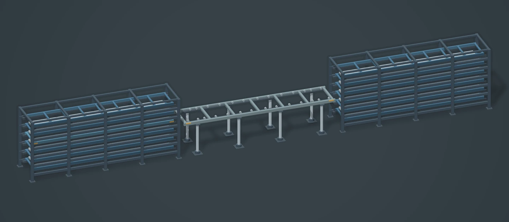

# Plate Storage System · 板材存放库

板材存放库的产品展示与三维取板演示。两侧固定货架各有六层，中央液压升降架对接目标层，活动架带板横移到中央工位，再由行车吊走板材。



## 运行

在仓库根目录安装依赖并启动 Streamlit：

```sh
python -m pip install -r requirements.txt
python -m streamlit run app.py
```

Windows 上安装依赖后也可双击 `启动演示.cmd`。在浏览器中打开终端打印的本地地址。

## 操作演示

在产品页面点击「操作三维演示」。选择左侧或右侧货架，再点选有板层位，观察升降对层、带板横移、行车吊板、空架归层与平台复位。演示支持暂停、继续、切换视角以及重置层位。

模型、尺寸比例和动画时间用于说明设备原理。
